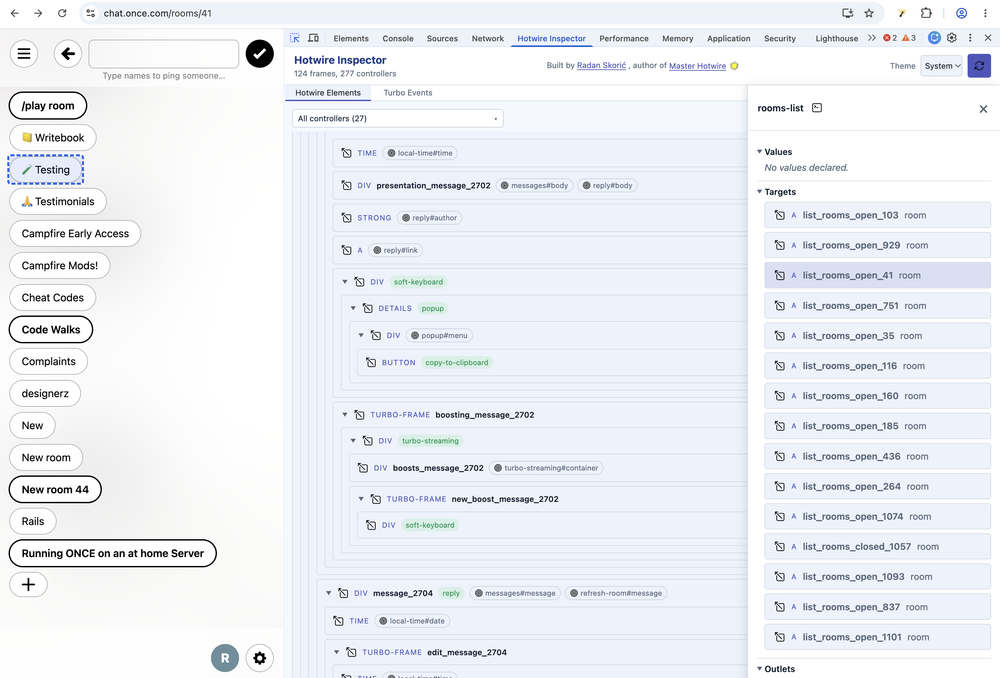

When building a mental model of a Hotwire-powered UI, it's very useful to focus just on the Hotwire components: *Turbo Frames, Stimulus controllers, their targets and Turbo events interacting with them*.

But the surrounding HTML can hide these components.[^1]

This is why I created the [Hotwire Inspector](https://inspector.masterhotwire.com/?utm_source=blog&utm_medium=announcement){:target="_blank"}: a browser extension for **inspecting** Hotwire applications. Get it? That's why it's called an **Inspector**. It's totally not because the "devtools" name was already taken.

I've been using it both to understand the overall Hotwire structure and to debug more complex interactions. My goal is an extension that makes it easy to quickly see the **high-level Hotwire architecture** and **dig into the details**.

I've found it especially useful for:

1. Building a mental model of a Hotwire-powered feature that I didn't work on. Either a colleague has asked me to review a new feature or I'm approaching an unfamiliar part of an existing application.
2. Quickly verifying that my AI coding agents have indeed implemented the Hotwire architecture we agreed on. *Because I have trust issues with them.*

The overviews allow me to get the big picture while Stimulus controller and Turbo event details help me dig in and debug.

I've also put extra effort into:

1. Minimising the impact on the application under inspection. I find it really annoying when I turn on a dev tools extension that modifies my application's elements and breaks some of my UI. That makes it really hard to use the extension.
2. Making Hotwire Inspector react to live changes on the page, from new elements appearing to Stimulus values changing.

> Get the extension at [https://inspector.masterhotwire.com/](https://inspector.masterhotwire.com/?utm_source=blog&utm_medium=announcement){:target="_blank"}.
{: .prompt-info}

It's still in early development, which is why I've labelled the current version v0.1. Any feedback or suggestions are more than welcome.

If you do find it useful, please let me know. It gives me motivation to continue working on it!

**Footnotes:**

[^1]: Especially if, like me on my side projects, you're using Tailwind CSS. I really like how easy it is to maintain, but I can't see shit in the Elements panel with all the CSS classes.
